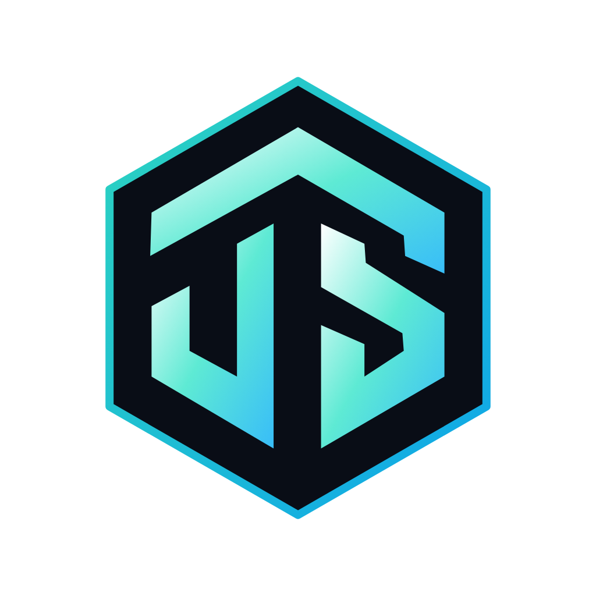
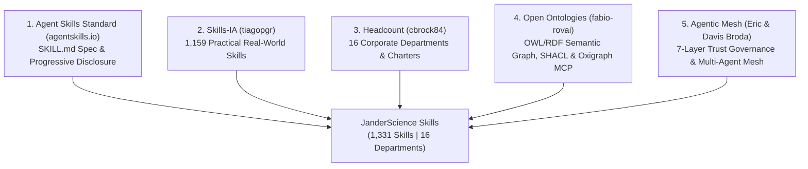
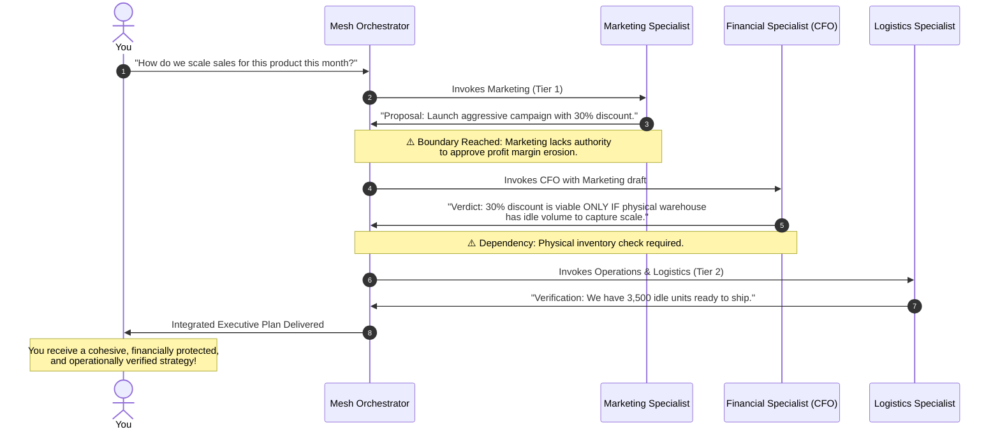

<div align="center">



# 🌐 JanderScience Skills

### Enterprise Agentic Mesh Workforce & Autonomous Organization System
**1,331 Specialized Skills Mapped Across 16 Corporate Departments**

🌐 **Languages:** **English** | [Português do Brasil](README.pt-BR.md)

[](https://agentskills.io)
[](#)
[](#)
[](https://github.com/fabio-rovai/open-ontologies)
[](#)
[](#)
[](mailto:jba1719@gmail.com)

</div>

---

```text
               /\                ██╗ ██████╗       ██╗███████╗
              /  \               ██║██╔════╝       ██║██╔════╝
             / /\ \              ██║███████╗       ██║███████╗
       /\   / /  \ \   /\        ██║╚════██║       ██║╚════██║
      /  \ / /    \ \ /  \       ██║███████║███████╗██║███████║
     / /\ Y /      \ Y /\ \      ╚═╝╚══════╝╚══════╝╚═╝╚══════╝
    | |  \ V        V /  | |   J A N D E R S C I E N C E   S K I L L S
    | |   \          /   | |   Enterprise Agentic Mesh Workforce
     \ \   \   /\   /   / /    1,331 Skills | 16 Corporate Departments
      \ \   \ /  \ /   / /     Spec: agentskills.io | Open Ontologies
       \ \   Y    Y   / /      
        \ \          / /       Developed by: Janderson B Abreu
         \ \________/ /        Support: jba1719@gmail.com
          \__________/         https://github.com/janderscience/janderscience-skills
```

---

## 📌 Table of Contents

- [Overview](#-overview)
- [The 5 Integrated Pillars](#-the-5-integrated-pillars)
- [How It Works in Practice](#-how-it-works-in-practice)
  - [Standalone Specialist vs. Autonomous Fleet](#standalone-specialist-vs-autonomous-fleet)
  - [The Boardroom Debate with Domain-Weighted Veto](#the-boardroom-debate-with-domain-weighted-veto)
- [Quick Installation (Industry Standard)](#-quick-installation-industry-standard)
  - [Via NPX (Zero Setup Required)](#via-npx-zero-setup-required)
  - [Global Installation via NPM](#global-installation-via-npm)
  - [Via Cargo (Rust Edition)](#via-cargo-rust-edition)
- [Ecosystem Metrics](#-ecosystem-metrics)
- [CLI Commands & Tooling](#️-cli-commands--tooling)
- [Repository Architecture](#-repository-architecture)
- [SHACL Governance & Formal Validation](#-shacl-governance--formal-validation)
- [Contact & Support](#-contact--support)

---

## 💡 Overview

**JanderScience Skills** bridges the gap between chaotic prompt catalogs and **Enterprise-Grade Autonomous AI Organizations**.

Instead of accumulating thousands of uncoordinated text files that breach context windows and operate without functional boundaries, this project establishes a **full corporate organization of 16 departments**, governed by **formal semantic ontologies (OWL/RDF)**, packaged under **Progressive Disclosure (`agentskills.io` standard)**, and hardened by a **Seven-Layer Trust Framework (Agentic Mesh)**.

---

## 🏛️ The 5 Integrated Pillars



1. **[Agent Skills Standard (agentskills.io)](https://agentskills.io)**:
   - Open specification leveraging **Progressive Disclosure**:
     - *Discovery*: Models read only lightweight metadata (`name` and `description`).
     - *Activation*: The operational instructions (`SKILL.md`) enter context only upon explicit invocation.
     - *Execution*: Reference manuals and executable scripts are loaded strictly on-demand.
   - Universal interoperability: Claude Code, Antigravity, Gemini CLI, Cursor, GitHub Copilot, and OpenAI Codex.

2. **[tiagopgr/skills-ia](https://github.com/tiagopgr/skills-ia)**:
   - **1,159 battle-tested skills** covering Marketing, Code, Product, Legal, Finance, Career, Operations, and Creative Direction.

3. **[cbrock84/headcount](https://github.com/cbrock84/headcount)**:
   - Enterprise organizational structure spanning **16 departments** (from the *Office of the CEO* through *Finance*, *SecOps*, *PMO*, and *Demand Generation*), establishing explicit departmental charters and strict write boundaries.

4. **[fabio-rovai/open-ontologies](https://github.com/fabio-rovai/open-ontologies)**:
   - High-performance semantic engine and MCP server written in Rust with Oxigraph triple store.
   - Formally maps: `Department -> Role -> Competency -> Skill -> MCP Tool`.
   - Generates OWL/RDF knowledge graphs and validates data integrity via **SHACL** (`ontologies/shacl_validation.ttl`).

5. **[Agentic Mesh (Eric & Davis Broda)](skill%20agentic_mesh/agentic-mesh/SKILL.md)**:
   - Decentralized microagent architecture and **Seven-Layer Trust Framework**:
     - **Tier 1 (Autonomous / Read-Only - 975 skills)**: Immediate, unhindered execution for research and drafting.
     - **Tier 2 (Audited Action / Internal - 236 skills)**: Monitored generation with audit logs and write restrictions.
     - **Tier 3 (High-Risk / Human-in-the-Loop - 120 skills)**: Hard gatekeeping requiring explicit human approval for treasury movements, hiring/firing, and contract signings.

---

## ⚙️ How It Works in Practice

### Standalone Specialist vs. Autonomous Fleet

* **Standalone Specialist Mode**:
  When you need surgical execution (e.g., *"Calculate the ROI for this paid media campaign"*), the system invokes **only the required skill** (`ia-financeiro-analise-de-roi`). It performs deep, specialized work without dragging unnecessary context.

* **Autonomous Fleet Mode (Cross-Functional Mesh)**:
  When you present a complex business goal (e.g., *"Launch a B2B SaaS product with a financial model, privacy policy, and inbound acquisition campaign"*), the orchestrator triggers an interdisciplinary team with **Dynamic Handoff**:
  1. The **CFO** models unit economics and pricing.
  2. The **Legal Counsel** drafts the terms of service and GDPR/LGPD compliance.
  3. The **Growth Lead** builds the inbound funnel and landing page copy.



---

### The Boardroom Debate (with Domain-Weighted Veto)

When evaluating high-risk initiatives, autonomous agents debate and cast structured votes using **Domain-Weighted Authority**:

```text
📋 JANDERCIENCE BOARDROOM VERDICT

  📈 Growth / Marketing: APPROVED (9/10)
     "Strong market demand; projected to triple product LTV."

  💻 Technology: APPROVED WITH CAVEAT (7/10)
     "Requires 4 weeks to establish zero-trust mTLS encrypted API bridges."

  💼 CFO / Finance: APPROVED (8/10)
     "Estimated payback in 45 days with healthy 22% net margins."

  ⚖️ Legal & Compliance: REJECTED / TEMPORARY HARD VETO (2/10)
     "Critical Alert: Requires prior central bank licensing. High regulatory exposure."

🎯 MESH CONSOLIDATED VERDICT:
PAUSED FOR ADJUSTMENT. Restructure regulatory positioning through an authorized Banking-as-a-Service partner prior to code deployment.
```

---

## ⚡ Quick Installation (Industry Standard)

### Via NPX (Zero Setup Required)
```bash
npx janderscience-skills
```
*Launches the interactive installer to configure skills into **Claude Code**, **Antigravity / Gemini CLI**, **Cursor IDE**, or the local project `./skills` directory.*

### Global Installation via NPM
```bash
npm install -g janderscience-skills

# Run interactive installer
janderscience-skills install

# Or install all 1,331 skills immediately
janderscience-skills install --all

# Run environmental health check
janderscience-skills doctor

# Search skills by keyword
janderscience-skills search "startup seed valuation financial model"
```

### Via Cargo (Rust Edition)
```bash
cargo install janderscience-skills
# or run locally:
cargo run -- stats
cargo run -- search "contract and compliance"
cargo run -- doctor
```

---

## 📊 Ecosystem Metrics

| Department | Official Title | Mapped Skills |
| :--- | :--- | :---: |
| `operations` | Business Operations | **346** |
| `marketing` | Brand & Product Marketing | **283** |
| `demand-generation` | Demand Generation & Growth | **255** |
| `finance` | Finance & Accounting | **146** |
| `legal-risk` | Legal, Compliance & Risk | **63** |
| `product` | Product Management | **55** |
| `people` | People & Talent (HR) | **50** |
| `technology` | Technology & Engineering | **41** |
| `executive` | Office of the CEO & Strategy | **33** |
| `it-operations` | IT Operations & Infrastructure | **12** |
| `revenue` | Revenue & Sales | **10** |
| `pmo` | Program Management Office | **9** |
| `security` | Information Security (SecOps) | **8** |
| `customer-experience` | Customer Experience & Success | **7** |
| `data-analytics` | Data & Analytics | **7** |
| `corporate-strategy` | Corporate Strategy | **6** |
| **TOTAL** | **16 Corporate Departments** | **1,331 Skills** |

---

## 🛠️ CLI Commands & Tooling

```bash
# View complete ecosystem metrics
node bin/cli.js stats

# Perform natural language semantic searches (EN or PT)
node bin/cli.js search "sales funnel copy landing page"
node bin/cli.js search "valuation startup rodada seed"

# Environmental diagnostic check
node bin/cli.js doctor

# Multi-Agent Mission Planner (Agentic Mesh)
python mesh_workforce/orchestrator.py "Validate B2B SaaS startup idea, compute financial model, draft terms of service, and launch inbound campaign"

# Recompile Master JSON Registry and Semantic RDF Graph (1+ MB RDF)
python tools/mesh_builder.py
```

---

## 📂 Repository Architecture

```text
janderscience-skills/
├── bin/
│   └── cli.js                      # Official Node.js CLI & NPX Installer
├── Cargo.toml                      # Rust Package / Cargo Crate Manifest
├── src/
│   └── main.rs                     # Self-contained Native Rust Binary
├── package.json                    # NPM Package Manifest for NPX distribution
├── logos/                          # Official brand visual assets
│   ├── janderscience-logo-dark-gradient.png
│   ├── janderscience-logo-text-gradient.svg
│   └── janderscience-logo-original.svg
├── registry/
│   └── mesh_registry.json          # Master Indexed JSON Registry (1,331 skills)
├── ontologies/
│   ├── workforce_schema.ttl        # OWL/RDF Department, Role & Skill Schema
│   ├── workforce_instances.ttl     # Semantic Knowledge Graph (10,000+ RDF Triples)
│   └── shacl_validation.ttl        # Formal SHACL Validation Shapes
├── mesh_workforce/
│   └── orchestrator.py             # Agentic Mesh Multi-Agent Fleet Orchestrator
├── tools/
│   ├── mesh_builder.py             # Ingestion, normalization & RDF generator
│   └── query_mesh.py               # Python discovery CLI
└── sources/                        # Integrated upstream repositories
    ├── skills-ia/                  # 1,159 pt-BR business skills (tiagopgr)
    ├── headcount/                  # 16 corporate departments & 172 skills (cbrock84)
    └── open-ontologies/            # High-performance Oxigraph semantic engine (fabio-rovai)
```

---

## 🛡️ SHACL Governance & Formal Validation

All 1,331 skills are verified against the SHACL shapes defined in [`ontologies/shacl_validation.ttl`](ontologies/shacl_validation.ttl):
1. **Unique Identification (`mesh:skillIdentifier`)**: Enforces zero slug collisions.
2. **Mandatory Department Membership (`mesh:belongsToDepartment`)**: Every specialist answers to a defined department and complies with its operational *Charter*.
3. **Declared Autonomy Tier (`mesh:autonomyTier`)**: Constrained to $\in \{1, 2, 3\}$, demarcating autonomous actions from audited steps and human-in-the-loop pauses.
4. **Discovery Metadata (`mesh:skillDescription`)**: Standardized minimum description enabling high-precision Progressive Disclosure.
5. **Auditable File Provenance (`mesh:skillSourcePath`)**: Full deterministic traceability back to the underlying `.md` skill file.

---

## 📬 Contact & Support

- **Developer:** Janderson B Abreu
- **Support Email:** [jba1719@gmail.com](mailto:jba1719@gmail.com)
- **Repository:** [https://github.com/janderscience/janderscience-skills](https://github.com/janderscience/janderscience-skills)
- **Standard:** [Agent Skills Foundation (agentskills.io)](https://agentskills.io)
- **License:** MIT
