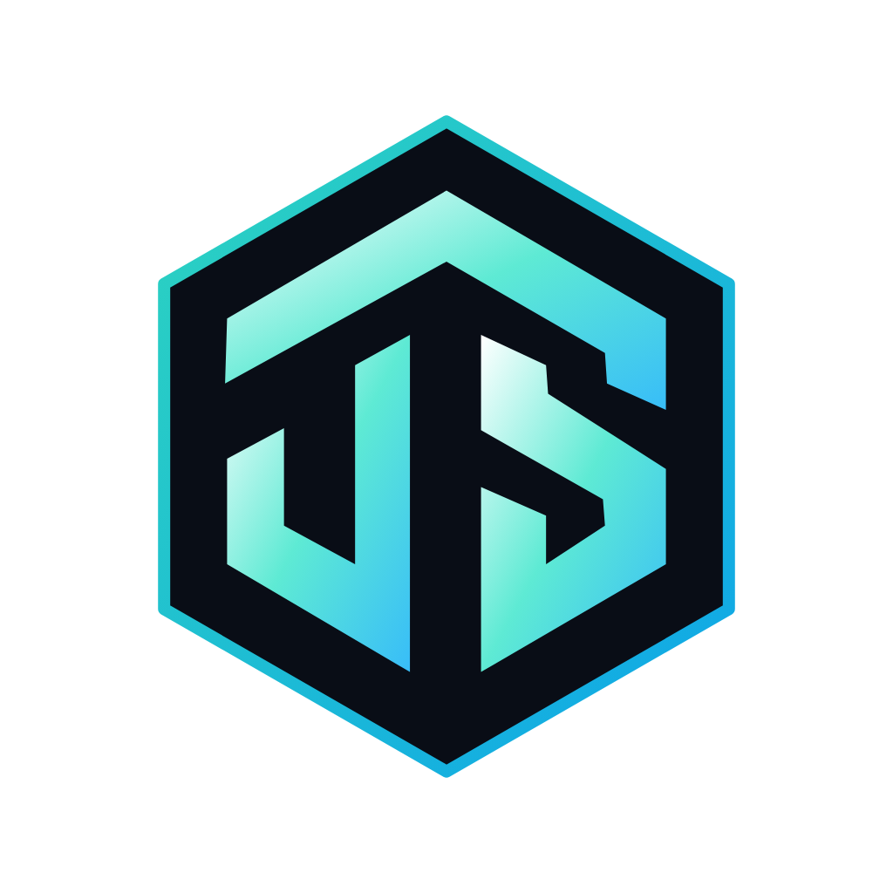
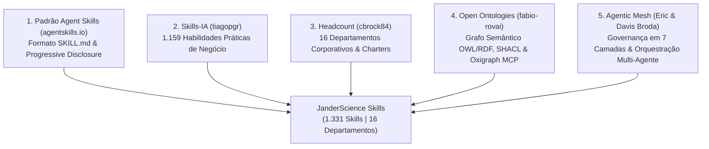
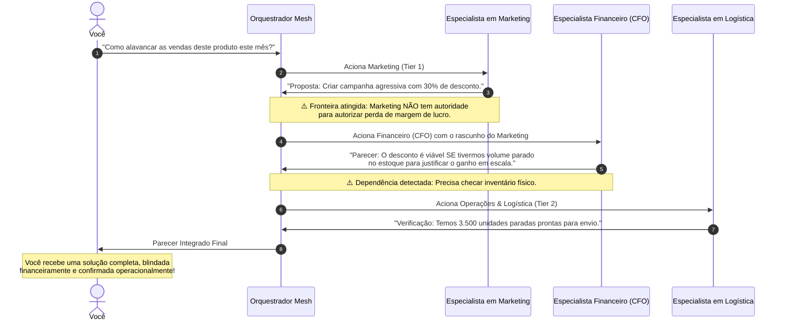

<div align="center">



# 🌐 JanderScience Skills

### Ecossistema Corporativo de Força de Trabalho Agentic Mesh e Organização Autônoma
**1.331 Habilidades Especializadas Mapeadas em 16 Departamentos Corporativos**

🌐 **Idiomas:** [English](README.md) | **Português do Brasil**

[](https://agentskills.io)
[](#)
[](#)
[](https://github.com/fabio-rovai/open-ontologies)
[](#)
[](#)
[](mailto:jba1719@gmail.com)

</div>

---

```text
               /\                ██╗ ██████╗       ██╗███████╗
              /  \               ██║██╔════╝       ██║██╔════╝
             / /\ \              ██║███████╗       ██║███████╗
       /\   / /  \ \   /\        ██║╚════██║       ██║╚════██║
      /  \ / /    \ \ /  \       ██║███████║███████╗██║███████║
     / /\ Y /      \ Y /\ \      ╚═╝╚══════╝╚══════╝╚═╝╚══════╝
    | |  \ V        V /  | |   J A N D E R S C I E N C E   S K I L L S
    | |   \          /   | |   Enterprise Agentic Mesh Workforce
     \ \   \   /\   /   / /    1.331 Skills | 16 Departamentos Corporativos
      \ \   \ /  \ /   / /     Spec: agentskills.io | Open Ontologies
       \ \   Y    Y   / /      
        \ \          / /       Desenvolvido por: Janderson B Abreu
         \ \________/ /        Suporte: jba1719@gmail.com
          \__________/         https://github.com/Jandersolutions/janderscience-skills
```

---

## 📌 Sumário

- [Visão Geral](#-visão-geral)
- [Os 5 Pilares Integrados](#-os-5-pilares-integrados)
- [Como Funciona na Prática](#-como-funciona-na-prática)
  - [Uso Isolado vs. Uso em Frota](#uso-isolado-vs-uso-em-frota)
  - [O Debate do Conselho Executivo](#o-debate-do-conselho-executivo-com-poder-de-veto)
- [Instalação Rápida (Padrão de Mercado)](#-instalação-rápida-padrão-de-mercado)
  - [Via NPX (Sem Instalação Prévia)](#via-npx-sem-instalação-prévia)
  - [Instalação Global via NPM](#instalação-global-via-npm)
  - [Via Cargo (Rust Edition)](#via-cargo-rust-edition)
- [Métricas do Ecossistema](#-métricas-do-ecossistema)
- [Comandos do CLI](#️-comandos-do-cli)
- [Arquitetura de Pastas](#-arquitetura-de-pastas-do-repositório)
- [Governança e Validação SHACL](#-governança-e-validação-shacl)
- [Contato e Suporte](#-contato--suporte)

---

## 💡 Visão Geral

O **JanderScience Skills** transforma bibliotecas dispersas de prompts em um **Sistema Operacional Corporativo de Inteligência Artificial**. 

Em vez de acumular milhares de arquivos de texto soltos que operam sem limites funcionais e estouram a janela de contexto das IAs, o projeto estabelece uma **organização corporativa completa com 16 departamentos**, governada por **ontologias semânticas formais (OWL/RDF)**, executada com **Progressive Disclosure (padrão agentskills.io)** e protegida por uma **Matriz de Confiança em 7 Camadas (Agentic Mesh)**.

---

## 🏛️ Os 5 Pilares Integrados



1. **[Agent Skills Standard (agentskills.io)](https://agentskills.io)**:
   - Especificação aberta com **Progressive Disclosure**:
     - *Descoberta (Discovery)*: O modelo lê apenas o nome e uma descrição leve (2 linhas).
     - *Ativação (Activation)*: As instruções do `SKILL.md` entram no contexto apenas quando acionadas.
     - *Execução (Execution)*: Scripts e referências são lidos sob demanda estrita.
   - Compatibilidade universal: Claude Code, Antigravity, Gemini CLI, Cursor, Copilot e Codex.

2. **[tiagopgr/skills-ia](https://github.com/tiagopgr/skills-ia)**:
   - **1.159 habilidades práticas** em português cobrindo Marketing, Vendas, Código, Produto, Jurídico, Financeiro, Carreira, Operações e Criação.

3. **[cbrock84/headcount](https://github.com/cbrock84/headcount)**:
   - Organograma empresarial com **16 departamentos** independentes (do *Office of the CEO* até *Finance*, *SecOps*, *PMO* e *Demand Generation*), com cartas de missão (*charters*) e limites rígidos de autoridade de escrita (*write boundaries*).

4. **[fabio-rovai/open-ontologies](https://github.com/fabio-rovai/open-ontologies)**:
   - Motor semântico e servidor MCP de alta performance em Rust com triplestore Oxigraph.
   - Mapeia formally os relacionamentos: `Department -> Role -> Competency -> Skill -> MCP Tool`.
   - Gera grafos de conhecimento OWL/RDF e valida conformidade via regras **SHACL** (`ontologies/shacl_validation.ttl`).

5. **[Agentic Mesh (Eric & Davis Broda)](skill%20agentic_mesh/agentic-mesh/SKILL.md)**:
   - Arquitetura de microsserviços e **Matriz de Confiança em 7 Camadas**:
     - **Tier 1 (Autônomo / Leitura - 975 skills)**: Execução autônoma imediata.
     - **Tier 2 (Ação Auditada / Interna - 236 skills)**: Rastreamento com limites de escrita.
     - **Tier 3 (Alto Risco / Human-in-the-Loop - 120 skills)**: Trava para aprovação humana obrigatória em movimentações bancárias, demissões e contratos legais.

---

## ⚙️ Como Funciona na Prática

### Uso Isolado vs. Uso em Frota

* **Uso Isolado (Modo Especialista / Standalone)**:
  Você precisa de uma tarefa cirúrgica (ex: *"Calcule o ROI desta campanha de tráfego"*). O sistema aciona **apenas uma skill específica** (`ia-financeiro-analise-de-roi`), executando o trabalho com profundidade máxima e sem poluir o contexto.

* **Uso em Frota (Modo Interdepartamental / Mesh)**:
  Você tem uma meta complexa (ex: *"Lançar um produto SaaS B2B com modelo financeiro, termos de uso e campanha de aquisição"*). O orquestrador aciona um time interdisciplinar com **Handoff Dinâmico**:
  1. O **CFO** calcula o modelo financeiro e unit economics.
  2. O **Jurídico** redige os termos de serviço e compliance LGPD.
  3. O **Growth/Marketing** monta a campanha de inbound e a landing page.



---

### O Debate do Conselho Executivo (Com Poder de Veto)

Ao avaliar novos projetos de alto risco, os agentes debatem e votam com **Autoridade Ponderada por Domínio (*Domain-Weighted Authority*)**:

```text
📋 PARECER DO CONSELHO EXECUTIVO JANDERSCIENCE

  📈 Growth / Marketing: APROVADO (9/10)
     "A demanda é alta e pode triplicar nosso LTV."

  💻 Tecnologia: APROVADO COM RESSALVA (7/10)
     "Precisaremos de 4 semanas para homologar as APIs com criptografia mTLS."

  💼 CFO / Financeiro: APROVADO (8/10)
     "Payback estimado em 45 dias com margem de 22%."

  ⚖️ Jurídico & Compliance: REPROVADO / VETO TEMPORÁRIO (2/10)
     "Alerta: Exige enquadramento regulatório prévio. Risco de multa e sanção."

🎯 VEREDITO CONSOLIDADO DO MESH:
PAUSADO PARA ADEQUAÇÃO. Ajustar enquadramento jurídico antes de iniciar o desenvolvimento técnico.
```

---

## ⚡ Instalação Rápida (Padrão de Mercado)

### Via NPX (Sem Instalação Prévia)
```bash
npx janderscience-skills
```
*Abre o instalador interativo para você escolher se deseja instalar no **Claude Code**, no **Antigravity / Gemini CLI**, no **Cursor IDE** ou no diretório `./skills` do projeto atual.*

### Instalação Global via NPM
```bash
npm install -g janderscience-skills

# Executar instalador interativo
janderscience-skills install

# Ou instalar tudo diretamente
janderscience-skills install --all

# Diagnosticar os ambientes instalados na máquina
janderscience-skills doctor

# Buscar qualquer habilidade
janderscience-skills search "valuation startup rodada seed"
```

### Via Cargo (Rust Edition)
```bash
cargo install janderscience-skills
# ou compilar localmente:
cargo run -- stats
cargo run -- search "contrato e risco"
cargo run -- doctor
```

---

## 📊 Métricas do Ecossistema

| Departamento | Nome Oficial | Habilidades Mapeadas |
| :--- | :--- | :---: |
| `operations` | Business Operations | **346** |
| `marketing` | Brand & Product Marketing | **283** |
| `demand-generation` | Demand Generation & Growth | **255** |
| `finance` | Finance & Accounting | **146** |
| `legal-risk` | Legal, Compliance & Risk | **63** |
| `product` | Product Management | **55** |
| `people` | People & Talent (HR) | **50** |
| `technology` | Technology & Engineering | **41** |
| `executive` | Office of the CEO & Strategy | **33** |
| `it-operations` | IT Operations & Infrastructure | **12** |
| `revenue` | Revenue & Sales | **10** |
| `pmo` | Program Management Office | **9** |
| `security` | Information Security (SecOps) | **8** |
| `customer-experience` | Customer Experience & Success | **7** |
| `data-analytics` | Data & Analytics | **7** |
| `corporate-strategy` | Corporate Strategy | **6** |
| **TOTAL** | **16 Departamentos Corporativos** | **1.331 Skills** |

---

## 🛠️ Comandos do CLI

```bash
# Ver as métricas completas do ecossistema
node bin/cli.js stats

# Fazer busca semântica em linguagem natural (PT ou EN)
node bin/cli.js search "funil de vendas copy landing page"
node bin/cli.js search "valuation startup rodada seed"

# Diagnóstico de agentes locais instalados
node bin/cli.js doctor

# Planejador de Missões Multi-Agente (Agentic Mesh)
python mesh_workforce/orchestrator.py "Validar ideia de startup SaaS B2B, calcular modelo financeiro, redigir termos de uso e criar campanha de inbound"

# Recompilar o Registro Mestre e o Grafo Semântico (1+ MB RDF)
python tools/mesh_builder.py
```

---

## 📂 Arquitetura de Pastas do Repositório

```text
janderscience-skills/
├── bin/
│   └── cli.js                      # Instalador oficial e CLI Node.js (NPX)
├── Cargo.toml                      # Manifesto do pacote Rust / Cargo Crate
├── src/
│   └── main.rs                     # Binário Rust nativo autossuficiente
├── package.json                    # Manifesto NPM para distribuição npx
├── logos/                          # Ativos de identidade visual oficiais
│   ├── janderscience-logo-dark-gradient.png
│   ├── janderscience-logo-text-gradient.svg
│   └── janderscience-logo-original.svg
├── registry/
│   └── mesh_registry.json          # Registro JSON mestre indexado (1.331 skills)
├── ontologies/
│   ├── workforce_schema.ttl        # Ontologia OWL/RDF de Departamentos, Cargos e Skills
│   ├── workforce_instances.ttl     # Grafo com mais de 10.000 triplas semânticas
│   └── shacl_validation.ttl        # Regras formais de validação SHACL
├── mesh_workforce/
│   └── orchestrator.py             # Orquestrador de frotas e governança Agentic Mesh
├── tools/
│   ├── mesh_builder.py             # Pipeline de ingestão, normalização e emissão RDF
│   └── query_mesh.py               # CLI Python de busca e inspeção
└── sources/                        # Repositórios upstream integrados
    ├── skills-ia/                  # Base de 1.159 skills em pt-BR (tiagopgr)
    ├── headcount/                  # Base de 16 departamentos e 172 skills (cbrock84)
    └── open-ontologies/            # Engine semântica em Rust / Oxigraph (fabio-rovai)
```

---

## 🛡️ Governança e Validação SHACL

Todas as 1.331 habilidades são formalmente validadas contra as regras do arquivo [`ontologies/shacl_validation.ttl`](ontologies/shacl_validation.ttl):
1. **Identificador Único (`mesh:skillIdentifier`)**: Nenhuma habilidade com slug duplicado.
2. **Vínculo Departamental Obrigatório (`mesh:belongsToDepartment`)**: Todo especialista responde a um departamento e cumpre o seu *Charter*.
3. **Classificação de Autonomia Declarada (`mesh:autonomyTier`)**: Valores $\in \{1, 2, 3\}$ definindo execução autônoma, ação auditada ou parada para autorização humana.
4. **Metadados de Descoberta (`mesh:skillDescription`)**: Descrição mínima padronizada para *Progressive Disclosure*.
5. **Caminho Físico Auditável (`mesh:skillSourcePath`)**: Rastreabilidade completa do arquivo fonte `.md`.

---

## 📬 Contato & Suporte

- **Desenvolvedor:** Janderson B Abreu
- **E-mail de Suporte:** [jba1719@gmail.com](mailto:jba1719@gmail.com)
- **Repositório:** [https://github.com/Jandersolutions/janderscience-skills](https://github.com/Jandersolutions/janderscience-skills)
- **Padrão:** [Agent Skills Foundation (agentskills.io)](https://agentskills.io)
- **Licença:** MIT
